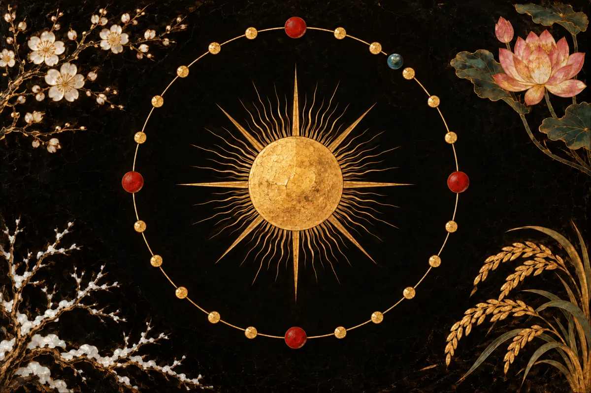
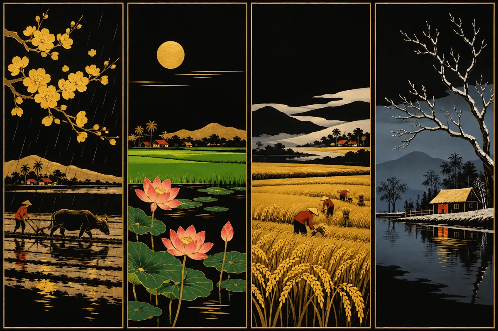

翻开一页挂历，除了农历和公历日期，常常还有一行小字：“立冬”“小雪”“冬至”……这就是**节气**。很多人以为节气是农历的一部分，其实它们跟随的是太阳，而不是月亮。

## 节气按太阳的位置来定

从地球上看，太阳一年中沿着一条叫**黄道**的路线在天空中走完一圈。这一圈被分成 24 个点，每两点相隔 **15°**。太阳每走到一个点，就开始一个新的节气。

0° 是**春分**。此后每增加 15° 就进入下一个节气：清明在 15°，谷雨在 30°，依此类推，冬至在 270°，立春在 315°。每个节气大约持续 15 或 16 天。

因为跟随太阳，节气每年几乎落在相同的公历日期，最多相差一天。这就是立春通常在 2 月 4 日或 5 日的原因。

## 四季的二十四节气

每个节气的名称都是对天气或农事的简短描述：

- **春季：**立春（春天开始）、雨水（雨水增多）、惊蛰（虫类苏醒）、春分（春季之中，昼夜几乎等长）、清明（天气清朗）、谷雨（雨养五谷）。
- **夏季：**立夏（夏天开始）、小满（谷粒稍满）、芒种（有芒的谷物）、夏至（夏季之中，北半球白昼最长）、小暑（稍热）、大暑（酷热）。
- **秋季：**立秋（秋天开始）、处暑（暑热结束）、白露（露水发白）、秋分（秋季之中，昼夜再次几乎等长）、寒露（露水变冷）、霜降（开始降霜）。
- **冬季：**立冬（冬天开始）、小雪（开始下小雪）、大雪（雪下得多）、冬至（冬季之中，北半球黑夜最长）、小寒（稍冷）、大寒（严寒）。

这些名称依据历法诞生地的气候而定。越南各地的天气可能不同：越南南部在小雪、大雪时并不下雪。对农民来说，立春等节点仍是为新一季准备农具和土地的时候。

## 可以核实的四个节点

春分、夏至、秋分和冬至也是天文台公布的四个天文时刻。根据美国海军天文台（USNO）2024 年的数据，换算成越南时间：

| 节气 | 时刻（越南时间） |
|---|---|
| 春分 | 2024年3月20日 10:06 |
| 夏至 | 2024年6月21日 03:51 |
| 秋分 | 2024年9月22日 19:44 |
| 冬至 | 2024年12月21日 16:20 |

由此可见，节气并不是约定俗成的数字：它们对应真实的天文时刻，可以精确到分钟。日历软件使用天文公式（例如 Jean Meeus 的公式）计算太阳黄经，找出每个节气开始的时刻。

## 为什么立春很少与春节重合

春节是农历正月初一，按月亮计算；立春则按太阳计算。两种算法不同，所以立春和春节没有固定的关系，只是偶尔才正好落在大年初一。

这对**八字**（四柱）有实际意义。在八字中，新的一年从立春开始，而不是从春节开始，每个月也从一个节气开始。因此，在春节之后、立春之前出生的人，年柱干支可能与平常按农历所说的年份干支不同。

## 节气决定闰月

农历需要节气，才不会偏离季节太远。二十四节气中，位于 30° 整数倍的 12 个点（如春分 0°、冬至 270°）称为**中气**。含有冬至的农历月为十一月。

一个农历月平均约 29.53 天，所以 12 个农历月只有大约 354 天，比太阳运行一圈短约 11 天。几年之后，就会出现一个不含任何中气的农历月。按照越南农历也沿用的中国传统历法规则，这个月就成为**闰月**。这样，春节始终落在冬末春初。

## 在 Qelunai 应用中查看节气

在 Qelunai 应用的“日历”标签中，“即将到来”一栏会列出每个节气的开始日期，以及初一和十五。日期按越南时间计算，因此可能与其他国家印制的日历相差一天。你也可以在网站的[农历](/zh/lich-am/)页面快速查看。

下次在日历上看到“立冬”二字时，你就知道太阳刚刚走到黄道上的 225°。
