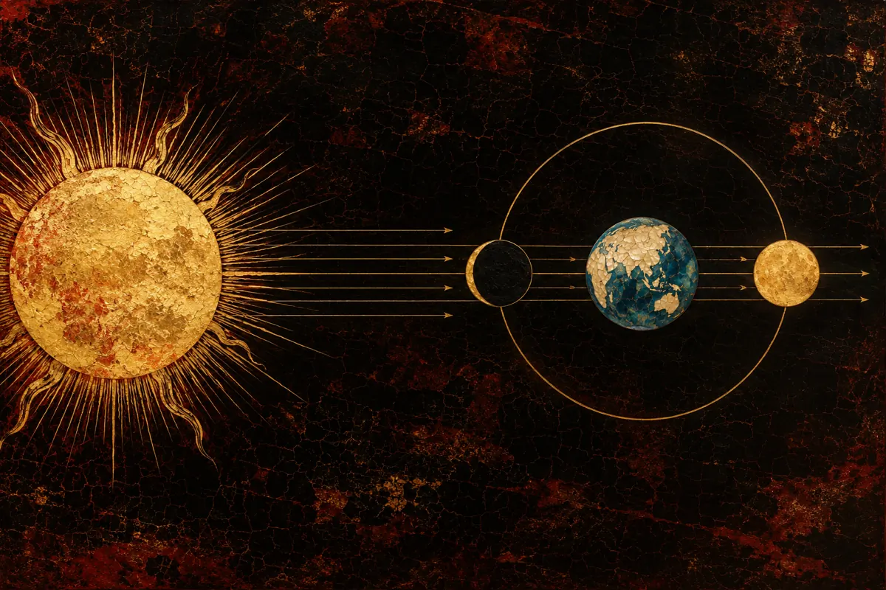
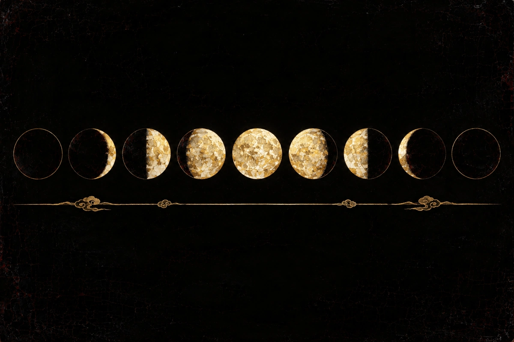
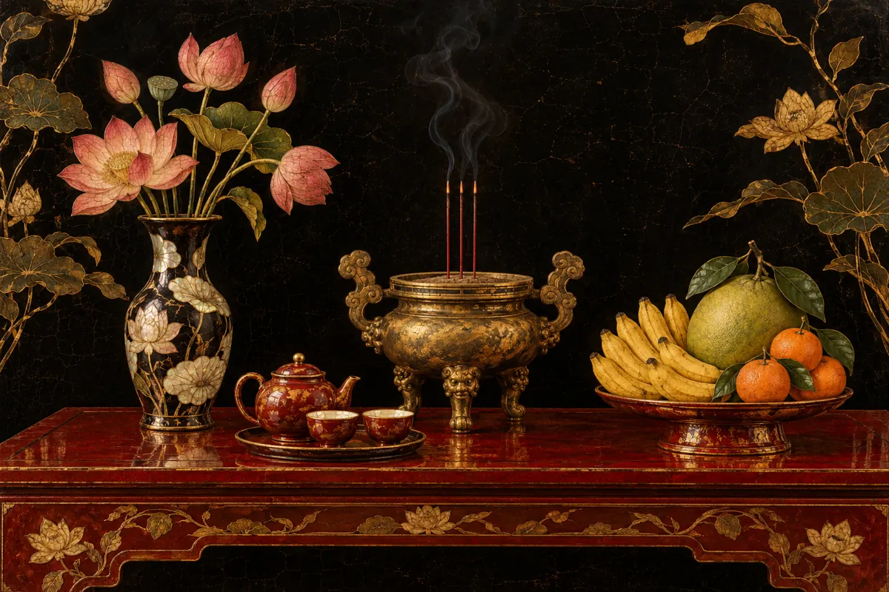

在许多越南家庭里，每个月有两天比其他日子记得更牢：初一和十五。这一天人们烧香，在供桌上摆放鲜花水果，有的人家还会相约去寺庙。可这两天从何而来？为什么有些月份越南农历会和邻国的农历差一天？

## 农历月从看不见月亮的那一刻开始

越南的农历其实是一种**阴阳历**。月份跟随月亮，而闰月和月份名称则以太阳的位置（节气）为准。

每个农历月从含有**朔**的那一天开始。朔是太阳、月亮和地球几乎排成一线的时刻，月亮把暗面朝向我们，所以几乎看不见。含有朔的那一天就是**初一**。

两次朔之间平均约 29.53 天。由于一个月必须是整数天，农历月有 29 天（小月）或 30 天（大月）。哪个月大、哪个月小没有固定规律，取决于真实的朔时刻。

## 十五是第十五天

**十五**是农历月的第十五天。满月出现在两次朔之间的中段，所以十五夜通常月亮明亮、接近圆满。不过，满月按月亮的真实位置计算，而十五只是数日子的方式，所以十五夜和“月亮最圆”的那一夜并不总是同一天。

一年中有几个大的十五有专门的名字，比如正月十五和七月十五。本文只谈每月的初一和十五。

## 为什么越南农历有时与别国不同？

朔是一个天文时刻，在全球同时发生。但它落在**哪一天**，则取决于时区。越南农历按越南时间（UTC+7）计算，中国农历用 UTC+8，韩国农历用 UTC+9。

如果朔落在午夜附近，两国就可能把初一定在不同的公历日期。开源库 doxuta/amlich 的文档中记载了一个例子：2027 年越南的春节是 **2027年2月6日**，而韩国的春节（Seollal）是 **2027年2月7日**。原因是那次朔落在越南时间 22:00–24:00 之间，按韩国时间已经是第二天。

因此，查看十五或初一时，最好使用按越南时间计算的日历。为其他市场制作的印刷日历或应用，在一年中的某几个月可能相差一天。

## 初一、十五的祭拜通常包括什么

各地、各家的习俗不尽相同。下面概括了越南媒体 VietNamNet、VTC News、Infonet 和《国际报》所刊祭文的共同点。这些文章大多写明依据文化通讯出版社的《越南传统祭文》一书。我们尚未读到原书。

**供品**在祝文中通常提到：香、花、茶、果。祭拜神灵的祝文还会提到金银纸（纸钱）。

初一和十五常用的**两篇祝文**：

- **祭神灵祝文**：敬拜皇天后土、东厨神君、土地龙脉以及管理家宅的诸位神灵，祈求全家平安。
- **祭祖先祝文**：恭请父系、母系的祖先降临鉴察，祈求家人健康、家庭和睦。

这些来源都有一个值得记住的小提示：如果父母仍健在，诵读祭祖先祝文时通常念“祖考、祖妣”，而不是“显考、显妣”。

《国际报》的简短版本称号较少，而 VietNamNet、VTC News 和 Infonet 的版本主体内容相同。没有哪一个版本是“唯一正确”的。如果你家有祖辈传下来的念法，照着做就好。

## 几点提醒

- 祭拜贵在诚心，不在供品多少。祝文里只提到香、花、茶、果。
- 初一和十五可能落在工作日。许多人家会在清晨或晚上上香。
- 家中有小孩时，请注意火和香的安全。

## 在 Qelunai 中留意初一和十五

Qelunai 的月历会标出初一、十五以及每个节气的开始日，直接在手机上按越南时间计算。当你选中初一或十五时，日历页面会多出一个按钮，可直接打开初一、十五的祭拜祝文阅读。
